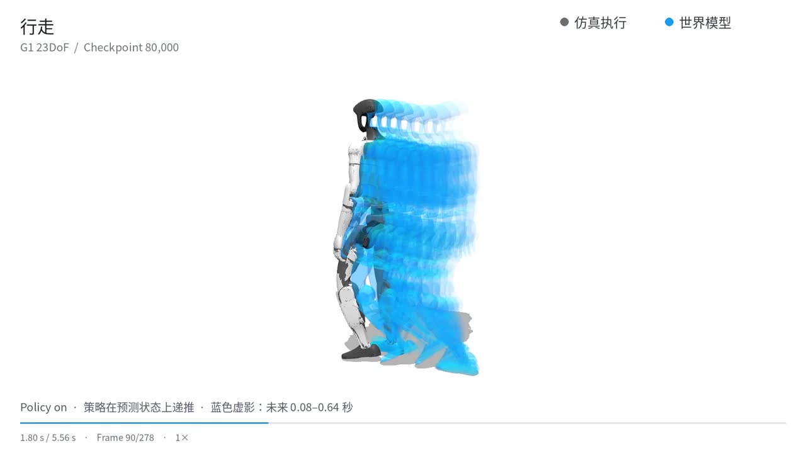

# G1 in Motion · SuperMimic 23DoF

原生 **23DoF Unitree G1** 的 SuperMimic 独立复现：SOMA 重定向、50Hz 参考动作、MuJoCo Warp 采样、可微世界模型与 32 步 BPTT。

[展示页面](https://supermimic-g1-23dof.fastknot.chatgpt.site) · [演示资源](https://github.com/yezheng04/supermimic-g1-23dof/releases/tag/v0.1.0-demo) · [网络与参数](docs/cuboileo_adaptation.md) · [评测结果](docs/results.md)



这是研究复现工程，不是 SuperMimic 官方代码。展示素材均为**预录仿真**，没有实机验证。评测快照中 80k 主样本回报最高，翻转和侧滚仍失败；当前尚未稳定收敛。

## 查看展示页

Python 3、Git 和已登录且拥有仓库访问权限的 GitHub CLI 即可，无需 CUDA。

```bash
gh repo clone yezheng04/supermimic-g1-23dof
cd supermimic-g1-23dof
python3 scripts/download_demo_assets.py
python3 -m http.server 8000 --bind 127.0.0.1 --directory website
```

打开 <http://localhost:8000>。可切换未来轨迹、预测对比、侧滚和翻转视频，调整播放速度，比较 8 个 checkpoint。网页不执行策略推理。静态源码位于 `website/`，可直接部署；无需 Node 或构建工具。私有托管页需要对应 ChatGPT 账户访问权限。

## 安装与训练

已验证栈：Python 3.11、PyTorch 2.7.1+cu128、mjlab 1.2.0、MuJoCo / MuJoCo Warp 3.5.0、Warp 1.12.0。正式配置针对 **2 × RTX PRO 6000 Blackwell 96GB**，每卡 4,096 环境。

```bash
# 需要预先安装 uv；创建隔离环境并检查两张 CUDA GPU。
bash scripts/setup_training_host.sh

# 人工站立动作仅用于安装/接口冒烟检查。
.venv/bin/sm23 demo
.venv/bin/python -m supermimic.scripts.train --config configs/smoke.json --check-config
```

先按 [数据准备](docs/data.md) 生成训练 manifest 和缓存，再启动正式训练：

```bash
wandb login
bash scripts/train_bones_2gpu.sh

# 在另一个终端记录 W&B；entity 改为自己的账号或团队。
.venv/bin/python -m supermimic.training.wandb_logger \
  --run-dir logs/bones_full_2gpu --project supermimic-g1-23dof --entity YOUR_ENTITY
```

`configs/rtx5080.json` 是小显存诊断配置，不等同于论文训练规模。正式训练恢复使用完整 checkpoint；Release 中可选的 80k 模型包仅含 Actor / 世界模型，不支持完整续训。

## 仓库内容

| 目录 | 内容 |
| --- | --- |
| `src/supermimic/` | 环境、FK、世界模型、Actor–Critic、训练和评测 |
| `configs/` | 双卡规模、轻量诊断及重定向配置 |
| `assets/` | 原生 23DoF URDF 与自建 SOMA 标定配置 |
| `scripts/` | 数据准备、训练、评测、诊断与视频生成 |
| `website/` | 响应式展示页、视频海报、评测 JSON |
| `evidence/post100k/` | 冻结样本清单、评测摘要、配对失败变化 |
| `docs/` | 数据流程、算法对应及实验记录 |
| `licenses/` | 保留的上游许可 |

原始数据、训练缓存、日志、环境及权重不进入 Git。视频和可选模型通过私有 Release 分发，并由 [资产清单](release-assets.json) 的 SHA-256 校验。BONES-SEED 原始数据需要从提供方单独获取。

## 开发

```bash
.venv/bin/python -m pytest -q
python3 scripts/check_repository.py
```

来源快照与整理时的变更见 [仓库说明](docs/repository.md)。训练失败和 Critic 审计保留在 [诊断记录](docs/critic_gradient_audit.md)，不将后续整理视为已经修复训练不稳定。

## 致谢与许可

感谢 [SuperMimic](https://supermimic.github.io)、[CuboiLeo](https://github.com/CuboiLeo/SuperMimic-Reproduced)、[kangzejian1896](https://github.com/kangzejian1896/supermimic-g1-reproduction)、[SOMA Retargeter](https://github.com/NVIDIA/soma-retargeter)、[Unitree](https://github.com/unitreerobotics/unitree_rl_mjlab) 和 [mjlab](https://github.com/mujocolab/mjlab)。展示页布局参考 [SuperMimic](https://supermimic.github.io) 与 [Proteus](https://proteushumanoids.vercel.app)，使用本项目视频与数据重新实现。

代码许可及来源见 [LICENSE](LICENSE)、[来源说明](docs/provenance.md) 和 `licenses/`。第三方机器人资源与数据保持各自许可；代码许可不覆盖 BONES-SEED 数据。
